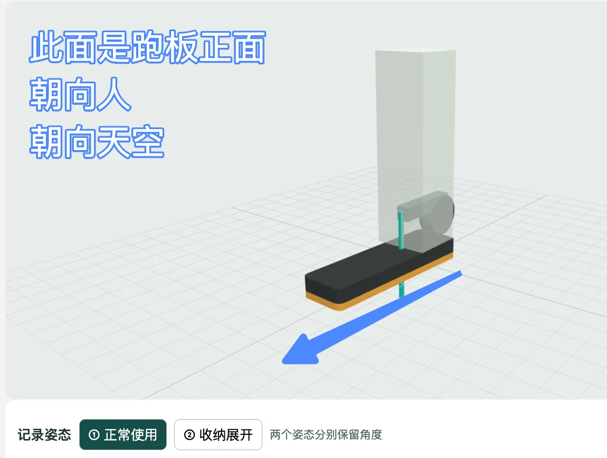
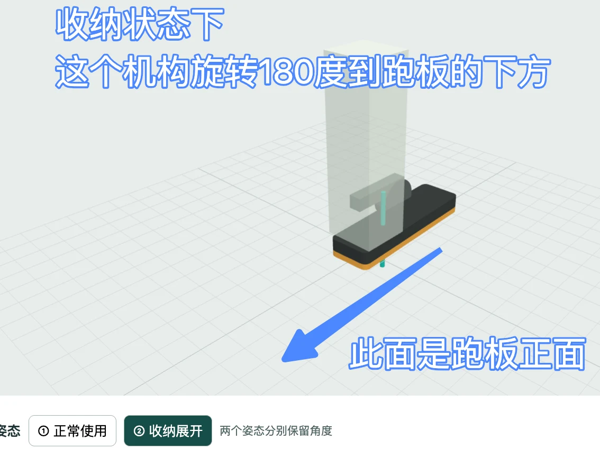

# 本轮设计对话归档

按对话先后整理。引号内为用户原话摘录，其余为需求或答复纪要。归档覆盖设计讨论、图像纠正与模型迭代，属于可接续工作的对话记录，并非平台逐字聊天导出。

## 1 · 调研任务与原始资料

用户要求「用 firecrawl 看看未来超前设计的跑步机外形是什么样的」「主要 focus 在一键折叠，带爬升坡度的」。调研基于立久佳 PDF、Z7PRO 既有项目与 Git 工作树，提出十几个设计方案。项目地址为 [整机模型](https://calfnai.github.io/lijiujia-z7pro-model/)。

用户要求「你给的这些色块图我看不懂，换成渲染图吗？同时保留色块图」。完成 [13 案研究页](https://calfnai.github.io/lijiujia-z7pro-model/research/)，保留色块图、案例照片与说明，新增 13 张可放大概念渲染。渲染中的简化机身只解释方案，整机造型回到 PDF 的 Linear 凌序。原资料《立久佳1-2-3压缩.pdf》共 191 页，P107–118 是跨品类外观参考；P175–180 是凌序方案，P178 含平放折叠、把手、2way 弹簧抽筒。存放位置为原对话附件，公开仓库不含整份 PDF。

## 2 · 侧饰板与已有尺寸

用户以一件有粗细条纹的实物做参考，要求在跑台下半侧面用塑料板装饰，去掉中间字母。「生产商说过，这个不可以做穿孔等复杂造型加工」。讨论的落点是实心板面、沿长度方向的粗细浅凸纹。一宽配若干细筋是候选排布，参考物的金色未定为产品颜色。

用户纠正「按截图这里的蓝色指示方向，现款的z7pro的太盛假的轮子比机身最前方（黄色标线）还要突出6cm」。此处指抬升架轮子。平放时轮子朝下受力，防滑支撑可以朝机头前方。60 mm 描述现款，未来的脚垫前伸量另算。厂家可进一步延长抬升架，延长量待定。

## 3 · 对 13 案的逐项质疑

| 编号 | 本轮评审记录 |
|---|---|
| 01、02、04、10、11、12 | 用户指出这些安装方式可能侵占立柱转轴。当前渲染无法证明装得进去，后续需画穿过梁端的剖视，标紧固位置、装配路径及运动避让。 |
| 02、03 | 散件容易在开箱后遗失，原设想退出优先队列。 |
| 05、06 | 用户质疑是否要自己拧紧。需用户逐次紧固的形式不接受。自动联动与锁止尚未验证。 |
| 07 | 双短臂方案保留在探索档案，本轮未列入优先名单。 |
| 08、09 | 原效果图有悬空问题，不能据此判断接地或稳定性。 |
| 04、10、11、13 | 用户当时认为这四个「比较靠谱」。11 首选，04 可作为接触面设计；10 与 13 保留作条件备选。12 的可换软鞋可等固定座有安装面后再议。 |

用户追问为何所有方案都默认跑板朝外，提出电机盖下沉、抬升架在底部，底部可做装饰。参考同厂 UOK 的折法，跑板正面较大面积平整，优先朝墙，底部凸起朝房间，减少靠墙侧空隙。用户确认「电机盖的轮廓可以与侧板的粗细浅凸纹呼应，让机器竖起来也像一件完整产品」。结构上仍需测折后表盘、扶手、墙距、重心及接地。

## 4 · 旋转方案如何被纠正

用户提供机头左右脚座图：「正常使用跑步机的时候，它不会把跑步机顶起来离开地面，在收纳的时候，它可以旋转过来，使跑步机站得更稳」。先后生成了脚座设错在机尾、四分之一圈旋转和铰链上下翻脚的图。用户认为方向仍错，要求「你先给我模型，我尝试掰给你看。就关于这个部件」。

于是制作了可调整轴向、转动范围、轴心与两个姿态的局部模型。用户用模型摆出正常使用与收纳展开两个位置并标出坐标。下面两张为用户实际标注，用来恢复本轮讨论的坐标方向。**图中的青轴落点随后被纠正，以居中模型为准。**

用户：「蓝箭头我是用来跟你表达坐标轴的。」蓝箭头指跑板正面，是固定的方向参照。黑金脚座整体旋转 180°，长端由跑板正面侧换到底面侧。

用户：「你刚才那根青轴是按错地方了。他应该居中在这条跑板的外框主力支撑梁上。」互动模型据此修正：青轴固定在外框主承力梁端面中心，脚座相对这根轴形成长短端。轴心在梁上居中，脚座自身偏心，两者可同时成立。长短比例仍为示意。蓝色箭头和青色轴的作用不同。

[打开已修正的模型，切换 ①／②](https://calfnai.github.io/lijiujia-z7pro-model/foot-study.html#axis=y&part=whole&p=-40&a=0&b=180&s=0)

同期两项明确修正：
- 用户：「不是左右各一个硅胶弹性外挂件，而是可以设计左右各一个或更多个，用来表达跑台弹性；实际减震结构你不用管，这是材料学问题。」
- 用户说明现款 Z7PRO 用 H 架支撑爬升，现款一根液压杆，成本允许且确有必要时可用两根。

## 5 · 最后确认与当前停点

用户：「你这次的理解对了，这作为其中一个solution。还有更简洁的解决方式，就是计算好11长主梁端部作为收纳底座 这个提案所意味着这支永久固定 的端部，到底要做多长多厚，才够支撑住整部机器，不易摔倒。」

答复区分了三个尺寸：端座前伸关系、有效接地深度和根部厚度。曾用 140 mm 完全有效接地、重心居中、1 m 高处施力举例，临界水平推力约为机重的 7%；若重心向受推侧偏 20 mm，则约为 5%。这些是假设算例。最终尺寸取决于实机质量与重心、接地点、载荷目标、梁材截面、安装方式及原型测试。

下一步详见[逐项版本表](roadmap.md)。用户希望各细节根据时间先后独立演进，两条底座方案都留档。

## 可追溯的仓库节点

| 提交 | 产物 |
|---|---|
| 84cf8af | 整机概念模型 v0.2 |
| ba79d45 | 13 案研究、下电机盖与主梁支撑探索 |
| dfbdbce | 保留色块图并增加渲染对照 |
| f1f4aae | 可调脚座动作模型 |
| ed850fc | 青轴改为外框主承力梁端面中心 |

## 6 · 阶段口径与厂商交付

用户明确：直到本人更新状态，项目保持概念稿阶段。把力学分析压缩成带图的工作流程，优先快速表达。厂商讨论用[一页图](brief/fixed-foot.svg)，先确定值得深化的方向。
