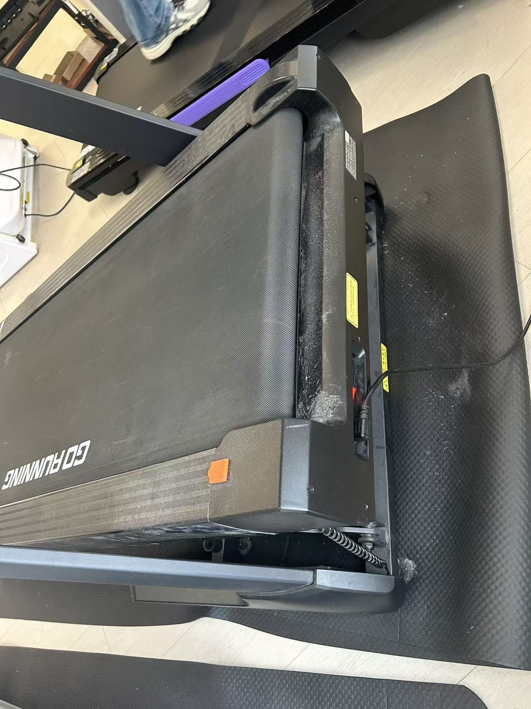
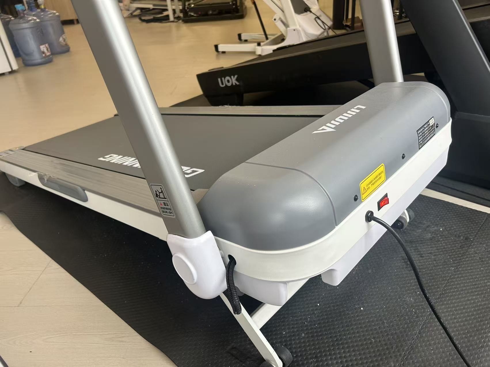

# 槽位01 · 全域跑台与低上盖对照

## 2026-11-03 · 跑台与马达盖新增依据

用户提供两张实拍，并说明黑色为全域跑台参考，白色为现款 Z7PRO。

- **A 全域跑台**：以黑色实拍的机头平整关系为参考，取消上凸马达盖，延续下置电机盖路线。黑色照片仅用于跑台/机头，不替换现款面板基准。
- **B 低上盖备选**：不做全域跑台时，上马达盖高度至少降低一半以上。概念表达暂以“高出跑带上表面的凸起高度”为比较基准，令现款 h0=100%，新盖 h≤50%h0，并优先画低于50%的版本。照片不用于推算未经测量的毫米数。
- 用户允许本阶段先忽略内部结构干涉；先表达造型，内部封装可行性不作已验证结论。原先折叠动作及外部饰件随动的表达要求仍保留。
- 槽位01初稿选择仍为待选。

